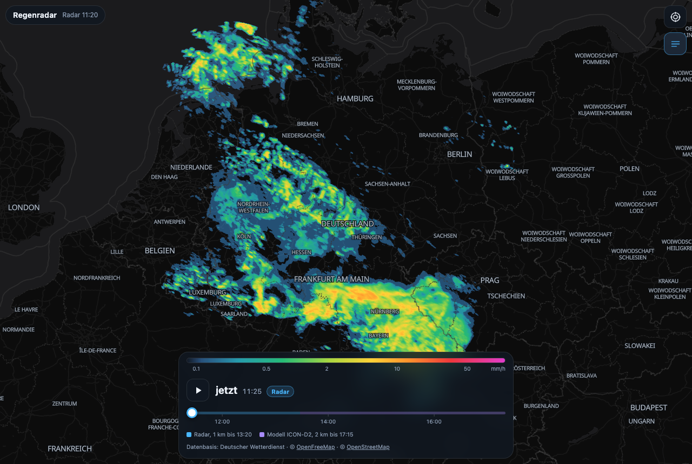
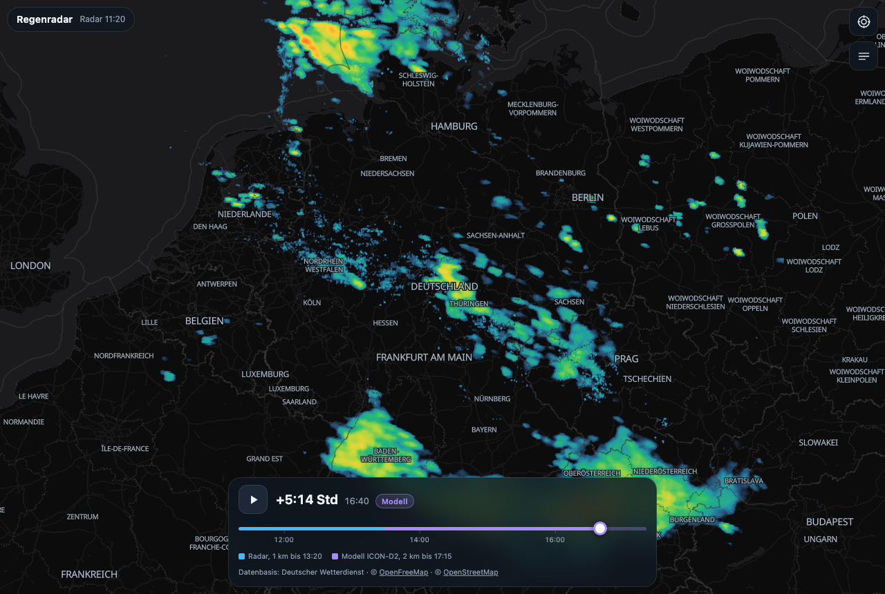

# Regenradar

Werbefreies Regenradar mit Vorhersage für die nächsten sechs Stunden — installierbar
als PWA, ohne Navigation, ohne Account, ohne Tracking.



---

## Was es kann

- **Karte statt Formular.** Eine Vollbildkarte, sonst nichts.
- **Nur Jetzt und Zukunft.** Der Zeitregler beginnt bei „jetzt" und reicht bis +6 h.
  Vergangenheit gibt es bewusst nicht.
- **Ehrlich über die Quelle.** Bis +2 h Radar, danach Modell — der Regler ist danach
  eingefärbt und benannt, statt beides als eine Vorhersage auszugeben.
- **Weiche Zeitübergänge.** Die Daten existieren nur alle 5 bzw. 15 Minuten. Zwischen zwei
  Zeitschritten wird nicht überblendet, sondern das Niederschlagsfeld anhand eines
  berechneten Bewegungsfelds *verschoben* — Regen zieht weiter, statt an einer Stelle
  zu verschwinden und an einer anderen zu erscheinen.
- **Punktabfrage.** Tippen auf die Karte beantwortet „regnet es gleich bei mir?" mit
  Klartext („Regen in ca. 20 Min, bis 12 mm/h") plus Verlaufsdiagramm.
- **Startet bei dir.** Beim Öffnen wird zuerst der Standort geholt und erst dann
  gezeichnet; ohne Freigabe erscheint das ganze Komposit. Nichts davon wird
  gespeichert — jeder Aufruf beginnt bei „hier und jetzt".
- **PWA.** Installierbar auf iOS und Android, Vollbild, App-Shell und Kartenkacheln
  offline vorgehalten.
- **Mobile und Desktop**, Tastatursteuerung (Leertaste, Pfeiltasten).

## Datenquellen

Zwei, beide vom DWD, beide Open Data unter GeoNutzV — kein API-Key, kein Limit, kein
Dritter.

| Zeitraum | Quelle | Auflösung | Takt |
|---|---|---|---|
| jetzt bis **+2 h** | **RV-Radarkomposit** | 1 km | 5 min, alle 5 min neu |
| **+2 h bis +6 h** | **ICON-D2** (Modell) | 2,2 km | 15 min, 8 Läufe/Tag |

**Sie werden nicht vermischt.** Das Radar ist genauer, solange es reicht, also gewinnt
es bis zu seinem letzten Frame und das Modell übernimmt ab dem nächsten Schritt. Die
Naht wird nicht versteckt, sondern angezeigt: der Zeitregler ist nach Quelle
eingefärbt — blau für Radar, violett für Modell — und ein Etikett neben der Uhrzeit
sagt, was gerade zu sehen ist.



**Abdeckung:** Deutschland plus 100–250 km darüber hinaus, also die Reichweite der
siebzehn deutschen Radare. Nachgemessen sind das 702 585 km², lon 4,4–16,1 /
lat 46,5–55,5 — Benelux, Schweiz, Österreich, Tschechien, Westpolen und Süddänemark
sind drin, Paris, Norditalien, UK und Skandinavien nicht. Das Modell deckt sogar
etwas mehr ab (lon −3,9…20,3 / lat 43,2…58,1), weshalb ab +2 h auch dort Regen
erscheint, wo vorher No-Data war.

### Warum die Grenze bei +2 h liegt

Das Radar-Nowcasting *extrapoliert*: Es misst, wie sich die Niederschlagsfelder in den
letzten Minuten verlagert haben, und schiebt sie weiter. Nach etwa zwei Stunden
entstehen und vergehen Zellen schneller, als Verlagerung das erklären kann — die Güte
fällt gegen null, und genau dort hört der DWD auf. Alles danach ist ein Modell, das
Atmosphärenphysik rechnet: eine andere Art von Vorhersage, kein längeres Radar.

Jenseits von etwa +6 h wäre ein scharf gezeichnetes Regenfeld Scheingenauigkeit — die
Zeitfehler eines Konvektionsmodells liegen dann bei Stunden. Deshalb der Standardwert;
`REGENRADAR_MODEL_HORIZON_HOURS` hebt ihn bis 48 h an.

### Warum ausgerechnet diese ICON-D2-Dateien

`icon-d2_germany_regular-lat-lon_single-level_*_2d_tot_prec.grib2.bz2`. Die
regular-lat-lon-Variante ist der Schlüssel: Sie ist mit GRIB2-Datenrepräsentation
**Template 0 (simple packing)** kodiert, die `backend/src/grib2.rs` in wenigen Dutzend
Zeilen liest. Die ikosaedrische Variante desselben Modells — und ganz ICON-EU —
verwendet Template 42 (CCSDS/AEC) und bräuchte eccodes oder einen eigenen
Entropiedecoder.

Zwei Eigenheiten, die man kennen muss:

- Die „stündliche" Datei enthält **vier Nachrichten**, nämlich die Viertelstunden.
  Der Modellteil hat also 15-Minuten-Auflösung, nicht die stündliche, die die
  Dateinamen nahelegen.
- `tot_prec` ist die **aufsummierte** Menge seit Modellstart. Die Rate einer
  Viertelstunde ist die Differenz zweier aufeinanderfolgender Nachrichten — deshalb
  wird immer eine Nachricht vor dem gewünschten Fenster mitgeladen.

Ein Lauf steht rund 80 Minuten nach seiner nominellen Zeit vollständig bereit
(gemessen: Lauf 12 UTC war um 13:21 UTC komplett). Der Ingest probiert deshalb den
neuesten Lauf und fällt auf den vorherigen zurück, solange der noch nicht da ist.

### Warum nicht europaweit

Weil es nicht geht, jedenfalls nicht frei und nicht in dieser Qualität. Die Details
stehen als Nachtrag in [`weather.md`](weather.md); kurz:

- **Radar reicht 150–250 km,** jeder Staat betreibt sein eigenes Netz. Ein
  europäisches Komposit gibt es nur als EUMETNET OPERA, und das ist
  lizenzbeschränkt — der DWD-GeoServer zeigt anonym nur dessen No-Data-Maske.
- **RainViewer hat keine Vorhersage** (`nowcast`-Array ist leer, geprüft).
- **Modelldaten als Ersatz kosten mehr, als sie bringen.** Open-Meteo zählt *jede
  Koordinate* als API-Call — gemessen 600/min und 10 000/Tag —, ein brauchbar dichtes
  Europaraster bräuchte zehntausende Punkte pro Aktualisierung. ICON-EU direkt vom
  DWD wäre unbegrenzt, liegt aber als GRIB2 mit CCSDS-Kompression (Template 42) vor
  und ist nur stündlich und bis zu 5 h alt.

Eine frühere Version dieser App hatte eine Open-Meteo-Ebene für den Rest Europas.
Sie war ~20 km grob, brauchte Quota-Verwaltung, Cache, Cooldown und Backoff, und war
überall dort unsichtbar, wo das Radar hinreicht. Der Verzicht darauf hat rund
900 Zeilen entfernt und die API auf eine parameterlose Query reduziert.

---

## Aufbau

```
backend/    Rust: axum + async-graphql
web/        Vite + TypeScript + MapLibre GL, PWA
shots/      Screenshots
```

Beide Quellen werden in **dasselbe** Web-Mercator-Raster gerechnet, wodurch die
veröffentlichte Ebene ein einziger durchgehender Frame-Stapel ist — der Client erfährt
nie, dass es zwei Quellen gibt, er bekommt nur längere Zeitstempel und pro Frame ein
`origin`. Die Geometrie kommt vom Radarlauf; verschiebt sich dessen Zuschnitt, wird
der Modellteil dagegen neu gerechnet.

Die GraphQL-API liefert **ausschließlich Metadaten** — welche Frames es gibt, wann
sie gelten, wo sie auf der Karte liegen, wie man sie dekodiert und einfärbt. Die
Pixel gehen als PNG über normales HTTP unter einer unveränderlichen, mit der Run-ID
gestempelten URL. Das ist es, was Browser und CDNs ohnehin gut cachen, und genau das,
was `texImage2D` haben will.

### Verarbeitungskette

1. **Ingest** (alle 5 min): `DE1200_RV_LATEST.tar.bz2` laden, 25 RADOLAN-Frames
   dekodieren.
2. **Zuschnitt:** Das DE1200-Gitter ist deutlich größer als die Radarreichweite. Jeder
   Lauf wird auf den Bereich beschnitten, in dem er tatsächlich Daten hat — über
   *alle* Frames hinweg, denn der Nowcast advehiert das Feld samt Datenrand, sodass
   ein später Frame Spalten erreicht, die die Analyse nicht hatte. Der Zuschnitt wird
   auf 64 Quellpixel gerundet, damit er zwischen den Läufen stabil bleibt und die
   Reprojektionstabelle nicht alle fünf Minuten neu gebaut wird.
3. **Reprojektion:** Das RADOLAN-Gitter ist polarstereographisch und gegen Nord
   verdreht. Es wird in ein achsenparalleles Web-Mercator-Raster umgerechnet, sodass
   der Client es als schlichtes Quad zeichnen kann. Die teure Umrechnung passiert
   einmal als Lookup-Tabelle und gilt dann für alle 25 Frames — aus zig Sekunden
   Trigonometrie werden ~2 s pro Lauf.
4. **Bewegungsschätzung:** Blockmatching zwischen aufeinanderfolgenden Frames ergibt
   ein grobes Verschiebungsfeld, das als winziges RGB-PNG mitgeliefert wird.
5. **Kodierung:** Regenrate logarithmisch auf 0–255, dann verlustfrei als
   einkanaliges WebP — je Frame in 8 × 8 Kacheln plus eine verkleinerte Übersicht.
6. **Modell:** parallel dazu ICON-D2 laden, Akkumulationen differenzieren, ins selbe
   Raster rechnen und an den Radarteil anhängen. An der Naht steht bewusst ein
   Null-Bewegungsfeld: Radar und Modell sind unabhängige Vorhersagen, und sie
   gegeneinander zu matchen würde eine Verschiebung erfinden, die nichts bedeutet.
7. **Client:** lädt Frames faul rund um den Abspielkopf, lädt sie als `R8`-Texturen
   hoch (ein Viertel des Speichers von RGBA) und interpoliert im Fragment-Shader.

Typischer Stand: Raster 1251 × 1250, ~42 Frames (25 Radar + 17 Modell) mit 41
Bewegungsfeldern. Der Server hält ~6,9 MB vor; ein Client lädt davon je nach Zoom
0,6–1,7 MB, und nur wofür er tatsächlich scrollt.

### Wie viel beim Client ankommt

Die Frames sind der einzige wiederkehrende Posten — alle fünf Minuten ein neuer Lauf,
während Kartenkacheln und JavaScript einmal geladen und dann gecacht werden. Zwei
Entscheidungen halten sie klein.

**Verlustfreies WebP statt PNG.** Gemessen über einen kompletten 41-Frame-Lauf:

| Format | Summe |
|---|---|
| PNG | 6348 KB |
| roh + brotli −q11 | 6190 KB |
| roh + zstd −19 | 6807 KB |
| Zeitdelta + brotli | 7518 KB |
| **WebP verlustfrei** | **4708 KB** |

Rohdaten mit Allzweckkompressor bringen nichts, und ein Zeitdelta ist sogar
schlechter: Regen *verschiebt* sich zwischen zwei Frames, eine wandernde Kante wird
im Differenzbild zu zwei Kanten, die Entropie steigt. Bildcodecs nutzen genau die
2D-Nachbarschaft, die diese Daten haben. Verlustbehaftet wäre nochmal 65 % kleiner,
wurde aber verworfen: bei Qualität 92 wichen einzelne Pixel um bis zu 16 % in mm/h
ab, und die Punktabfrage liest diese Bytes als Daten, nicht als Bild.

(Der reine Rust-Encoder `image-webp` schöpft davon nur einen Teil aus — gegen
libwebp's `-z 9` fehlen ihm etwa 15 Prozentpunkte. Das ist der Preis dafür, keine
C-Toolchain zu brauchen.)

**Kacheln statt ganz Deutschland.** Jeder Frame liegt als 8 × 8 Kacheln à 157 px vor
*und* als eine auf 313 px verkleinerte Übersicht. Der Client nimmt, was sein
Ausschnitt tatsächlich abdeckt: herausgezoomt die Übersicht, weil der Bildschirm
ohnehin nicht mehr auflöst; hineingezoomt die paar Kacheln im Blickfeld. Die Kacheln
landen per `texSubImage2D` in *einer* Textur, wodurch der Shader nichts davon merkt —
er sampelt über uv und erfährt nie, dass das Bild in Stücken ankam. Beim Verschieben
werden fehlende Kacheln nachgeladen.

**Erst orten, dann zeichnen.** Die Karte wartet mit der Niederschlagsebene, bis der
Standort da ist oder abgelehnt wurde. Der Grund ist derselbe wie oben: Frames werden
für das geladen, was auf dem Schirm ist, und bei Deutschland-Zoom ist das das ganze
Kachelraster — das gleich darauf weggeworfen würde, sobald die Karte zu dir springt.
Gemessen beim Erstaufruf: **444 KB mit Ortung, 823 KB ohne.** Das Warten ist gedeckelt
(5 s), denn ein unbeantworteter Berechtigungsdialog darf die App nicht blockieren.

Die Ansicht wird bewusst **nicht** gespeichert. Ein Regenradar ist eine Frage nach
hier und jetzt; die Kartenposition von letzter Woche stünde nur im Weg.
`?at=<lat>,<lng>,<zoom>` setzt den Startausschnitt für einen Aufruf — gelesen, nie
zurückgeschrieben, damit ein geteilter Link auf einen Ort zeigt, ohne dass die App
klebrig wird. Bei so einem Link entfällt die automatische Ortung.

Gemessen, kompletter Durchlauf durch alle sechs Stunden:

| Kartenzoom | vorher | jetzt |
|---|---|---|
| Deutschland (z 5,4) | 5644 KB | **1081 KB** |
| Region (z 7) | 5644 KB | **626 KB** |
| Stadt (z 9–11) | 5644 KB | **1679 KB** |

Bei Stadtzoom ist es mehr als bei Regionszoom, weil dort volle 1-km-Auflösung geladen
wird statt der Übersicht — mehr Bytes, aber für einen Bruchteil der Fläche und in
voller Schärfe.

Feinere Kacheln kosten fast nichts: von 4 × 4 auf 8 × 8 stieg die Gesamtmenge auf dem
Server um 3 KB, weil die meisten Kacheln ohnehin leer sind.

### Speicher

Der Ingest schaufelt pro Lauf einige Dutzend mehrere Megabyte große Raster durch den
Speicher. Drei Dinge halten das im Rahmen:

- **Der Radarlauf wird gestreamt**, ein Frame zur Zeit, in zwei Durchgängen über das
  Archiv — der erste ermittelt den Zuschnitt, der zweite rechnet dagegen. Alle 25
  Frames gleichzeitig als `f32` zu halten wären 125 MB für drei Megabyte Ergebnis.
- **Der Modellteil differenziert im Vorbeigehen:** `tot_prec` ist kumulativ, eine Rate
  braucht genau zwei Nachbarn, also bleibt immer nur die vorige Akkumulation liegen.
- **mimalloc als Allokator.** Mit dem Systemallokator wuchs die Resident-Größe über
  mehrere Läufe auf ~360 MB, bevor sie sich einpendelte — reine Fragmentierung, kein
  Leck. Gemessen mit `repeated_builds_do_not_grow` (siehe Tests).

Ergebnis: ~100 MB nach dem Radarlauf, ~200 MB mit Modellteil, stabil über die Läufe.

### Warum 1430 m/px

Weil darunter nichts mehr gewonnen ist. Die Quelle ist ein 1-km-Gitter am Boden, und
Mercator streckt mit `1/cos(Breite)`: ein Bodenkilometer sind 1431 Mercator-Meter am
Südrand des Komposits (45,68° N) und mehr weiter nördlich. Feiner abzutasten
interpoliert nur noch. Umgekehrt hat die vorherige Einstellung von 1600 m/px den
Süden leicht unterabgetastet.

### Georeferenzierung

Der heikelste Teil, deshalb gegen echte Daten geprüft: Die DE1200-Gitterparameter
wurden gegen Bright Skys `latlon_position` für fünf über das Gitter verteilte Städte
(Berlin, München, Köln, Zürich, Kiel) gefittet — der implizierte Gitterursprung
stimmt auf **unter 1 m** überein. Die Zeilenreihenfolge des Binärformats (Süd → Nord)
wurde durch direkten Vergleich einer Rohdatei mit Bright Skys Dekodierung desselben
Zeitstempels bestätigt. Beides liegt als Test in `backend/src/proj.rs`.

### Zeitinterpolation

Für einen Zeitpunkt mit Anteil `f` zwischen Frame A und B gilt: das Regenpaket, das
jetzt bei `uv` ist, kam von `uv - f·flow` und zieht nach `uv + (1-f)·flow`. Der
Shader liest also beide Frames an ihrer jeweils verschobenen Position und mischt
dann. Genau das macht Videobild-Interpolation, hier auf Regen angewandt.

### Warum es keine Maske im Shader braucht

Außerhalb der Radarabdeckung ist die kodierte Intensität null, und die Farbrampe ist
dort transparent — die Ebene endet also von selbst genau dort, wo das Radar endet.
Die Abdeckungsmaske wird trotzdem ausgeliefert, aber nur die Punktabfrage nutzt sie:
Sie ist der Unterschied zwischen „hier ist es trocken" und „hierhin reicht kein
Radar".

---

## Container und Deployment

Ein Image, keine Abhängigkeiten. Es gibt keine Datenbank, kein Volume, kein Secret —
jede Vorhersage liegt im Speicher und ist nach einem Neustart innerhalb weniger
Sekunden wieder da.

```bash
docker run -d -p 8787:8787 --read-only ghcr.io/emcell/regenradar:latest
```

`deploy/regenradar.yaml` enthält Deployment, Service und Ingress; `deploy/compose.yaml`
das Äquivalent für einen einzelnen Docker-Host. In beiden nur Image-Referenz und
Hostname anpassen.

`deploy/helm/regenradar` ist dasselbe als Helm-Chart (Ingress und/oder Gateway-API-
HTTPRoute); so läuft regen.emcellsoft.de, ausgerollt per Flux aus dem Infra-Repo.

**Für die PWA braucht es HTTPS.** Service Worker und „Zum Home-Bildschirm" verlangen
einen sicheren Kontext, Ausnahme ist nur `localhost`. Ohne Zertifikat bleibt es eine
normale Website — deshalb steht im Manifest ein Ingress mit TLS.

**Eine Replik genügt.** Jede zusätzliche lädt und reprojiziert jeden DWD-Lauf für
sich, verdoppelt also den Verkehr nach oben und die CPU, ohne etwas beizutragen, das
ein Cache davor nicht besser könnte.

**Zwei getrennte Proben.** `/healthz` antwortet 200, solange der Prozess lebt —
ein schlechter Moment beim DWD löst damit keinen Neustart aus, der ohnehin nichts
reparieren würde. `/readyz` sagt, ob es tatsächlich eine Vorhersage auszuliefern
gibt, und darauf sollte der Load Balancer routen. Das Image prüft sich per
`regenradar --healthcheck` selbst, weshalb kein `curl` darin liegen muss.

Gemessen an einem laufenden Container: **123 MB Image**, nach 6 s bereit, ~210 MB
Speicher im Betrieb, läuft als uid 10001 mit schreibgeschütztem Dateisystem.

### Warum cross-kompiliert statt emuliert

Das Dockerfile baut `linux/amd64` und `linux/arm64` beide auf der Architektur des
Builders und kompiliert für das Ziel — der Rust-Build unter QEMU macht aus zwei
Minuten eine halbe Stunde. Nötig sind dafür pro Ziel ein Cross-Compiler *und* dessen
libc-Header: `mimalloc`, `bzip2-sys` und `ring` übersetzen C, und `gcc-<arch>-linux-gnu`
allein scheitert am ersten `#include`.

## CI

`.github/workflows/ci.yml`:

| Job | Was |
|---|---|
| `backend` | `cargo fmt --check`, `clippy -D warnings`, `cargo test` |
| `frontend` | `tsc --noEmit`, `vite build` |
| `e2e` | Image bauen, starten, Playwright dagegen laufen lassen |
| `image` | Multi-Arch bauen und nach GHCR pushen |

`image` hängt an `e2e`, es wird also nichts veröffentlicht, was den Durchlauf gegen
einen echten Container nicht bestanden hat. Der e2e-Job baut zuerst für die
Runner-Architektur und wärmt damit den Layer-Cache, den der Multi-Arch-Push danach
wiederverwendet.

Die e2e-Stufe zieht **echte DWD-Daten**. Das ist Absicht — genau die Teile, die am
ehesten brechen, würde ein Mock zudecken — bedeutet aber eine externe Abhängigkeit
in der Pipeline.

## Starten

Voraussetzungen: Rust (2021 Edition), Node 20+.

```bash
# Backend
cd backend
cargo run --release          # http://localhost:8787

# Frontend (separates Terminal)
cd web
npm install
npm run icons                # einmalig: PWA-Icons erzeugen
npm run dev                  # http://localhost:5173, proxyt auf 8787
```

Für den Einzelprozess-Betrieb das Frontend bauen — das Backend liefert `web/dist`
dann unter `/` mit aus:

```bash
cd web && npm run build
cd ../backend && cargo run --release
# alles auf http://localhost:8787
```

### Konfiguration

Alles über Umgebungsvariablen, alles optional:

| Variable | Standard | Bedeutung |
|---|---|---|
| `REGENRADAR_BIND` | `0.0.0.0:8787` | Adresse |
| `REGENRADAR_WEB_DIR` | `../web/dist` | Frontend-Build; fehlt er, läuft nur die API |
| `REGENRADAR_DWD_URL` | DWD Open Data | Quelle des RV-Komposits |
| `REGENRADAR_DWD_POLL_SECS` | `60` | Prüfintervall auf neuen Lauf |
| `REGENRADAR_DWD_RESOLUTION_M` | `1430` | Rasterauflösung (Mercator-Meter/Pixel) |
| `REGENRADAR_DWD_CROP_SNAP` | `64` | Rundung des Zuschnitts in Quellpixeln; `1100` schaltet ihn praktisch ab |
| `REGENRADAR_MODEL_ENABLED` | `true` | Modellteil abschaltbar (dann endet die Achse bei +2 h) |
| `REGENRADAR_MODEL_HORIZON_HOURS` | `6` | wie weit der Modellteil reicht, max. 48 |
| `REGENRADAR_MODEL_POLL_SECS` | `600` | Prüfintervall; geladen wird nur, wenn sich Lauf oder Fenster ändern |
| `REGENRADAR_MODEL_URL` | DWD Open Data | Basis-URL des ICON-D2-Verzeichnisses |

### API

`/graphql` (mit GraphiQL unter `/graphiql`), `/healthz`, `/data/{layer}/{run}/{file}`.

```graphql
{
  radar {
    ready
    timeline {
      start end stepSeconds
      segments { origin start end label run }
    }
    intensity { minMmh maxMmh }
    colorScale { at r g b a }
    layers {
      id label run width height resolutionMeters
      bounds { west south east north }
      frames { index time forecast origin }
      flowUrls flowMaxPixels
      tiling {
        cols rows tileWidth tileHeight overviewWidth overviewHeight
        tileUrlTemplate overviewUrlTemplate maskUrlTemplate
      }
    }
  }
}
```

---

## Tests

```bash
cd backend && cargo test          # 52 Tests
cd web && npm test                # 72 Playwright-Tests (Desktop + Mobile)
```

Der GRIB2-Decoder hat zusätzlich einen Test gegen eine echte DWD-Datei, der bewusst
nicht automatisch läuft:

```bash
REGENRADAR_TEST_GRIB=/pfad/zu/datei.grib2 cargo test -- --ignored --nocapture
REGENRADAR_TEST_RV=/pfad/zu/DE1200_RV_LATEST.tar.bz2 cargo test -- --ignored --nocapture
```

Der zweite baut denselben Lauf sechsmal und prüft, dass die Resident-Größe sich
einpendelt statt zu wachsen.

Die Playwright-Suite läuft absichtlich gegen das echte Backend mit echten DWD-Daten:
Genau die Teile, die am ehesten brechen — RADOLAN-Dekodierung, Georeferenzierung,
Texturformate — würde ein Mock zudecken. Sie sucht sich die nasseste Stelle im
aktuellen Komposit selbst, richtet die Karte dorthin aus und prüft dann, dass
tatsächlich gefärbte Pixel gezeichnet werden, dass sich das Bild beim Scrubben
ändert und dass Zwischenzeitpunkte innerhalb eines 5-Minuten-Intervalls
unterschiedliche Bilder ergeben — das ist der Nachweis, dass die
Bewegungsinterpolation wirkt. Wo es gerade nirgends regnet, überspringt sie sich
selbst mit Begründung.

Screenshots neu erzeugen: `npm run screenshots` (gegen ein laufendes Backend).

---

## Lizenz und Quellenangabe

Die Datenlizenz verlangt Namensnennung; die App zeigt sie dauerhaft an:

- **Datenbasis: Deutscher Wetterdienst** (GeoNutzV) — RV-Radarkomposit und ICON-D2
- Karte: **OpenFreeMap** / **OpenStreetMap**-Mitwirkende
